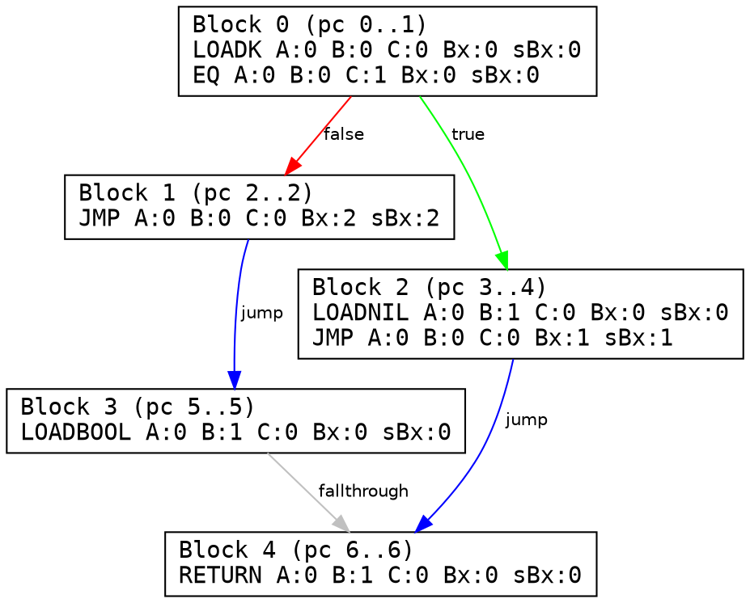

# lua-verify

Static bytecode analyzer, Control Flow Graph (CFG) reconstructor, and register liveness verifier for the Lua 5.1 Virtual Machine. Written from scratch in idiomatic OCaml with zero external runtime dependencies.

---

### Overview

The Lua 5.1 VM executes 32-bit instructions on a register-based stack under the assumption of well-formed bytecode. Malformed or manipulated chunks can trigger out-of-bounds branches, stack leakage, or memory corruption.

`lua-verify` provides formal binary analysis and verification of compiled chunks prior to execution:
- **Zero-Dependency Binary Deserializer**: handles raw stream decoding, target endianness, variable-length `size_t`, and IEEE 754 float reconstruction via `Int64`.
- **Instruction Decoder**: bitfield unpacking of all 38 VM opcodes across `iABC`, `iABx`, `isBx` formats with `RK` operand resolution.
- **Jump Validity Checker**: formal bounds checking for relative jumps (`sBx`) and conditional branch continuity.
- **CFG Reconstruction**: basic block leader partitioning and Graphviz `.dot` visual export with colored edge classification.
- **Definite Assignment Analysis**: forward dataflow fixed-point iteration ($\bigcap$ meet operator) proving the absence of uninitialized register reads.

---

### Architecture

```text
lib/
├── bytecode/               # Binary parsing & VM representation
│   ├── header.ml / .mli    # 12-byte chunk signature & target configuration
│   ├── reader.ml / .mli    # Stream cursor, endianness & string decoding
│   ├── instruction.ml/.mli # 32-bit bitmask unpacking & opcode variants
│   └── proto.ml / .mli     # Prototype AST, constants & debug metadata
└── analysis/               # Verification & dataflow passes
    ├── jump_checker.ml/.mli# Relative branch safety & boundary assertions
    ├── cfg.ml / .mli       # Basic block partitioning & Graphviz DOT export
    └── liveness.ml / .mli  # Use-Def extraction & register dataflow analysis
```

---

### Formal Verification & Dataflow

Register initialization is verified via forward dataflow analysis over the lattice of available registers:

```text
entry boundary:
  IN[entry] = { 0, 1, ..., num_params - 1 }

confluence (meet operator):
  IN[B] = ⋂ OUT[P]    (for all predecessors P of B)

block transfer:
  OUT[B] = IN[B] ∪ GEN[B]

safety invariant:
  ∀ I ∈ B, ∀ r ∈ uses(I) : r ∈ Assigned_current  (else: VIOLATION)
```

---

### Output Preview

#### 1. Control Flow Graph (Graphviz DOT)



#### 2. Verifier Diagnostics

```text
=== Jump Verification Report ===
  Status: FAILED (2 violations):
    [VIOLATION] at pc 1 (JMP sBx:99) jumps to 101 (out of bounds [0..2])
    [VIOLATION] conditional test at pc 2 has no following instruction

=== Liveness & Register Verification ===
  Status: FAILED (1 uninitialized reads detected):
    [BUG] at pc 0: instruction 'MOVE A:0 B:5 C:0 Bx:0 sBx:0' reads uninitialized register R(5)
```

---

### Build & Run

```bash
# Build bytecode & analysis libraries
dune build

# Run test suite & verifier passes
dune exec lua-verify
```

---

### Roadmap

- [x] Binary chunk header & environment validation
- [x] Zero-dependency binary reader (endianness, IEEE 754 floats, size_t)
- [x] 32-bit instruction bitfield decoder & RK operand resolver
- [x] Recursive prototype AST & constant table parser
- [x] Relative jump out-of-bounds verifier
- [x] Control Flow Graph (CFG) builder (Leader Algorithm)
- [x] Graphviz DOT exporter with branch classification
- [x] Definite assignment dataflow analysis
- [ ] Standalone CLI driver for external `.luac` files
- [ ] Static Single Assignment (SSA) IR translation
