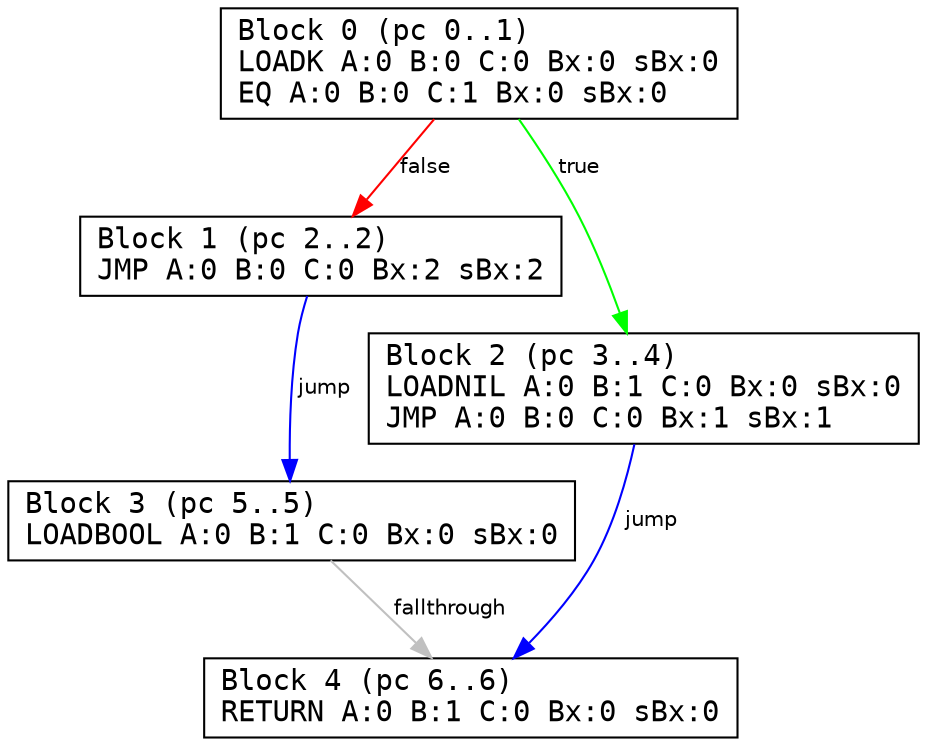

# lua-verify

static bytecode analyzer, control flow graph (cfg) reconstructor, and register liveness verifier for the lua 5.1 virtual machine. written from scratch in idiomatic ocaml with zero external runtime dependencies.

---

### overview

the lua 5.1 vm executes 32-bit instructions on a register-based stack under the assumption of well-formed bytecode. malformed or manipulated chunks can trigger out-of-bounds branches, stack leakage, or memory corruption.

`lua-verify` provides formal binary analysis and verification of compiled chunks prior to execution:
- **zero-dependency binary deserializer**: handles raw stream decoding, target endianness, variable-length `size_t`, and ieee 754 float reconstruction via `Int64`.
- **instruction decoder**: bitfield unpacking of all 38 vm opcodes across `iABC`, `iABx`, `isBx` formats with `RK` operand resolution.
- **jump validity checker**: formal bounds checking for relative jumps (`sBx`) and conditional branch continuity.
- **cfg reconstruction**: basic block leader partitioning and graphviz `.dot` visual export with colored edge classification.
- **definite assignment analysis**: forward dataflow fixed-point iteration ($\bigcap$ meet operator) proving the absence of uninitialized register reads.

---

### architecture

```text
lib/
├── bytecode/               # binary parsing & vm representation
│   ├── header.ml / .mli    # 12-byte chunk signature & target configuration
│   ├── reader.ml / .mli    # stream cursor, endianness & string decoding
│   ├── instruction.ml/.mli # 32-bit bitmask unpacking & opcode variants
│   └── proto.ml / .mli     # prototype ast, constants & debug metadata
└── analysis/               # verification & dataflow passes
    ├── jump_checker.ml/.mli# relative branch safety & boundary assertions
    ├── cfg.ml / .mli       # basic block partitioning & graphviz dot export
    └── liveness.ml / .mli  # use-def extraction & register dataflow analysis
```

---

### formal verification & dataflow

register initialization is verified via forward dataflow analysis over the powerset lattice $\mathcal{P}(\{0 \dots \text{max\_stack\_size}-1\})$:

- **entry boundary**:
  $$\text{IN}[\text{entry}] = \{0, 1, \dots, \text{num\_params} - 1\}$$

- **confluence (meet operator)**:
  registers are valid only if initialized across **all** incoming execution paths:
  $$\text{IN}[B] = \bigcap_{P \in \text{preds}(B)} \text{OUT}[P]$$

- **transfer function**:
  $$\text{OUT}[B] = \text{IN}[B] \cup \text{GEN}[B]$$
  $$\forall I \in B, \; r \in \text{uses}(I) \implies r \in \text{Assigned}_{\text{current}} \quad (\text{else } \text{VIOLATION})$$

---

### output preview

#### 1. control flow graph (dot)



#### 2. verifier diagnostics

```text
=== Jump Verification Report ===
  Status: FAILED (2 violations):
    [VIOLATION] at pc 1 (JMP sBx:99) jumps to 101 (out of bounds [0..2])
    [VIOLATION] conditional test at pc 2 has no following instruction

=== Liveness & Register Verification ===
  Status: FAILED (1 uninitialized reads detected):
    [BUG] at pc 0: instruction 'MOVE A:0 B:5 C:0 Bx:0 sBx:0' reads uninitialized register R(5)
```

---

### build

```bash
# build bytecode & analysis libraries
dune build

# run test suite & verifier passes
dune exec lua-verify
```

---

### roadmap

- [x] binary chunk header & environment validation
- [x] zero-dependency binary reader (endianness, floats, size_t)
- [x] 32-bit instruction bitfield decoder & rk operand resolver
- [x] recursive prototype ast & constant table parser
- [x] relative jump out-of-bounds verifier
- [x] control flow graph builder (leader algorithm)
- [x] graphviz dot exporter with branch classification
- [x] definite assignment dataflow analysis
- [ ] standalone cli driver for external `.luac` files
- [ ] static single assignment (ssa) ir translation
